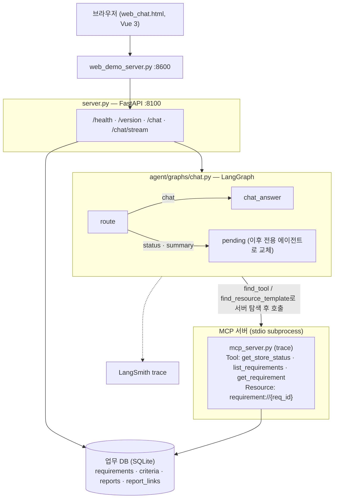

# req-trace-agent — 요구사항 진척 관리 에이전트

개발자가 남긴 **완료 보고**를 **요구사항 명세서**와 연결해 진척 현황을 대시보드로 보여주고, 검수·대금 청구용 **요구사항 추적표 엑셀**을 만들어 주는 에이전트 서비스다. 진척은 채팅으로도 물어볼 수 있다.

> 강의 Base 코드(운영 인시던트 대응 에이전트, Vue 버전)의 골격을 출발점으로 삼았다. 재사용한 부분은 FastAPI, LangGraph, MCP stdio, SSE, 세션 DB, LLM 백엔드 토글, Vue 화면이고, 도메인은 새로 설계했다. 진행 계획은 [doc/plan.md](doc/plan.md)에 있다.

## 왜 만드나

- 공공 SI는 검수 때 요구사항마다 완료 여부와 근거를 추적표로 제출해야 대금이 나온다.
- 지금은 그 현황을 사람이 메신저와 엑셀로 모은다. 그래서 무엇이 남았는지 늦게 알게 된다.
- AI가 코드를 보고 완료 여부를 **판정**하게 하면, 틀렸을 때 그대로 검수에 들어간다. 이 프로젝트는 그 방식을 쓰지 않는다.
  - **사실의 출처는 개발자의 완료 보고**다.
  - AI는 보고를 정리하고 요구사항에 매핑하고 요약하는 역할만 맡는다.
  - AI 제안은 항상 사람이 확인한 뒤에 저장한다.
  - 상태(완료, 부분완료, 미착수)는 확정된 완료 조건의 충족 여부로 **코드가 계산**한다.

## 동작 (목표)

| 화면 | 동작 |
|---|---|
| 요구사항 | 명세서 엑셀을 업로드한다. AI가 요구사항마다 완료 조건 체크리스트 초안을 만들고 담당자가 확정한다 |
| 완료 보고 | 이름과 한 일을 자유롭게 적는다. AI가 해당 요구사항, 충족한 조건, 근거(파일·API·PR)를 정리해 제안한다. 개발자가 **확인**해야 저장된다 |
| 대시보드 | 전체 진척률, 분류별·담당자별 현황, 진척 추이, 위험 신호를 보여준다. **검수용 엑셀**을 내보낸다 |
| 채팅 | "보안 요구사항 진행률은?", "SFR-005 남은 거 뭐야?", "이번 주 완료된 거 정리해줘" 같은 질문에 답한다 |

## 진행 현황

| 단계 | 내용 | 상태 |
|---|---|---|
| setting | 인시던트 도메인 제거, 패키지 구조, LLM 공통화, 업무 DB 스키마, 탭 화면 골격, 테스트·CI | ✅ |
| requirements | 명세서 업로드, 완료 조건 초안 생성·확정 | ⏳ |
| report-intake | 완료 보고 정리 에이전트(RAG 매핑 + 담당자 확인) | ⏳ |
| dashboard-export | 대시보드, 검수용 엑셀 | ⏳ |
| chatbot | 현황 질의응답·요약 에이전트 | ⏳ |
| eval | 매핑 정확도·답변 수치 일치율 평가, 문서 | ⏳ |

## 현재 구조



- **의존성 주입**: 노드는 `SupervisorDeps`(LLM, MCP, 업무 DB, 세션 DB, 설정)로만 외부에 접근한다. 테스트는 FakeLLM과 MCP 스텁을 꽂아 그래프를 그대로 돌린다.
- **LLM 계층**: `agent/llm/remote.py`가 프롬프트·JSON 파싱·형식 보정을 맡고, `ollama.py`·`openai.py`는 통신만 구현한다. Base 코드에서 두 파일이 75% 가까이 중복되던 부분을 정리했다. 모든 호출은 async다.
- **업무 DB와 세션 DB 분리**: 실행 스크립트는 채팅 이력(`session.db`)만 초기화하고, 요구사항과 완료 보고(`data/req_trace.db`)는 유지한다.

## 실행

```bash
bash sh/setup_venv.sh          # .venv + 의존성 (최초 1회)
cp .env.example .env           # 필요 시 값 수정
bash sh/setup_ollama.sh        # qwen3:0.6b · qwen3:8b (로컬 모델)
bash sh/run_agent_ollma.sh     # 백엔드 :8100
bash sh/run_frontend.sh        # 새 터미널 → http://localhost:8600
```

- 네트워크 없이 확인: `LLM_BACKEND=fake .venv/bin/python3 server.py`
- OpenAI(과금): `bash sh/run_agent_openai.sh`
- 테스트: `.venv/bin/python3 -m pytest -q`. 네트워크와 Ollama 없이 돌고, PR마다 GitHub Actions에서 실행된다.

## 디렉터리

```
├── server.py                 FastAPI 백엔드 (lifespan 싱글턴, SSE)
├── web_demo_server.py        화면 + 백엔드 프록시 (:8600)
├── web_chat.html             Vue 3 화면 (탭: 대시보드 · 완료 보고 · 요구사항 · 채팅)
├── mcp_server.py             MCP 서버 "trace" (요구사항·진척 조회)
├── agent/
│   ├── config.py · deps.py · state.py · prompts.py · retry.py · mcp_client.py
│   ├── graphs/               그래프 조립 (chat)
│   ├── nodes/                노드 1개 = 파일 1개 (route · chat · pending)
│   ├── llm/                  remote(공통) · ollama · openai · fake · rules
│   └── store/                업무 DB 스키마·조회, 세션 DB
├── tests/                    pytest (MCP 실연동·서버 조립 포함)
├── sh/                       설치·실행 스크립트
└── doc/plan.md               진행 계획
```
